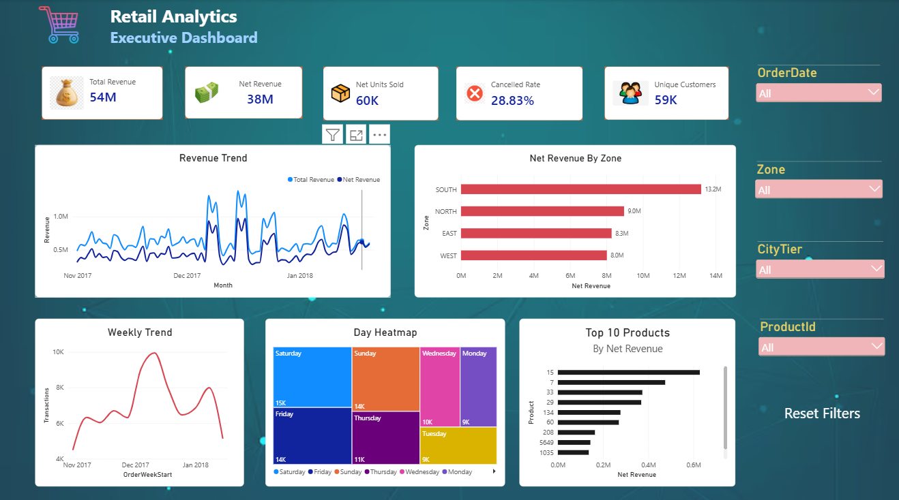

# Retail Sales & Customer Analytics

An end-to-end retail analytics project combining Python-based exploratory data analysis with an interactive Power BI report.

## Tools & technologies
- Python
- Pandas and NumPy
- Power BI
- DAX

## Project overview
The project explores retail transactions, customer information and product categories to understand purchasing behaviour, store/channel performance and customer segments.

## Analysis covered
- Dataset structure, data types, missing values and transaction quality
- Transaction history and monthly activity
- City-level customer, transaction and revenue comparisons
- Gender-wise product category and sub-category preferences
- Store-format performance, comparing sales value and quantity
- Flagship-store category contribution
- Repeat-purchase behaviour and loyal-customer identification
- Age-cohort spending patterns and a date-bounded campaign window

## Power BI Dashboard

The interactive dashboard provides insights into retail sales performance, revenue trends, customer activity, product performance and regional comparisons.

### Dashboard Preview



### Dashboard Highlights

- Revenue and customer KPIs
- Monthly and weekly sales trends
- Zone-wise revenue analysis
- Day-wise transaction patterns
- Top 10 products by net revenue
- Interactive slicers and filters

The Power BI file is available in `powerbi/Retail_Analytics_Dashboard.pbix`.

## Python notebook
Open `notebooks/Retail_Analytics.ipynb` in Jupyter Notebook or JupyterLab.

## Data files required
The original data files are not included in this repository. Place the authorized source files in a folder named `data/` using these exact filenames:
- `Customer.csv`
- `prod_cat_info.csv`
- `Transactions.csv`

The notebook reads the files from the relative `data/` folder. Do not upload datasets containing personal, confidential or licensed information unless you have permission to share them.

## How to run
1. Clone or download this repository.
2. Install the Python packages: `pandas` and `numpy`.
3. Add the three required CSV files to `data/`.
4. Open and run `notebooks/Retail_Analytics.ipynb`.
5. Open the PBIX file using Power BI Desktop to explore the report.

## Repository structure
```text
retail-sales-customer-analytics/
├── notebooks/
│   └── Retail_Analytics.ipynb
├── powerbi/
│   └── Retail_Analytics_Dashboard.pbix
├── images/
│   └── retail-dashboard.png
├── data/                  # Add source CSVs locally; not tracked
├── .gitignore
└── README.md
```
